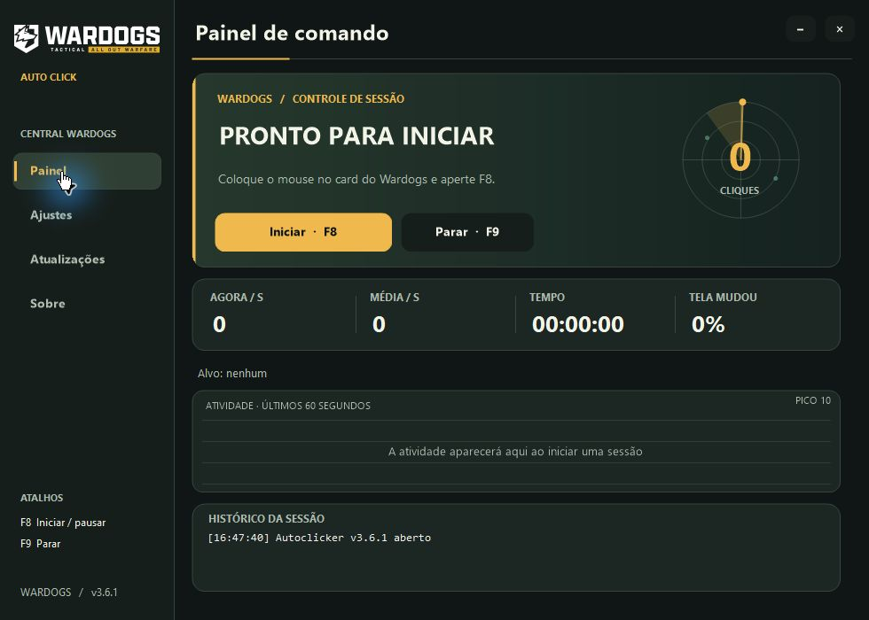
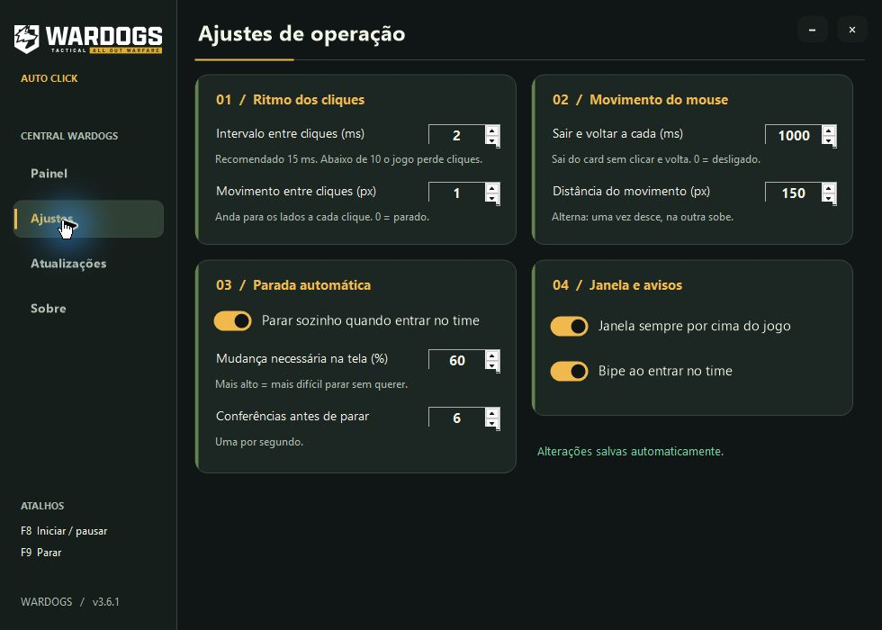
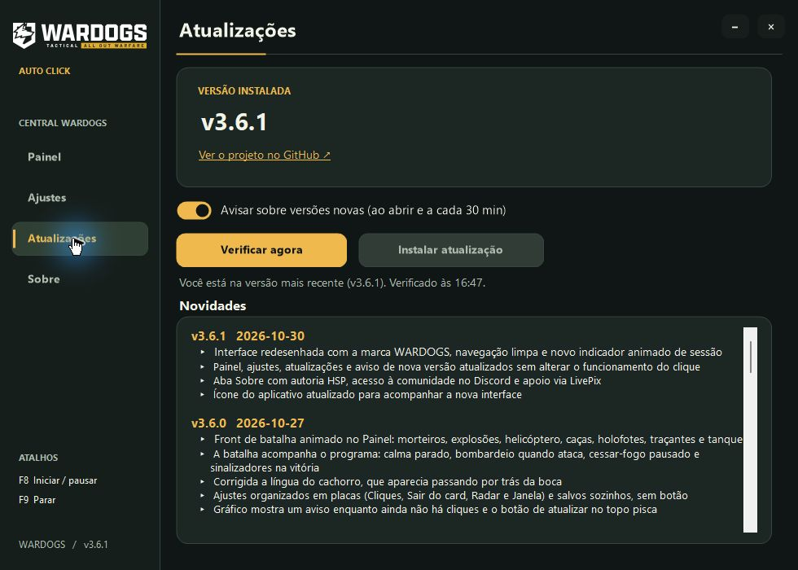
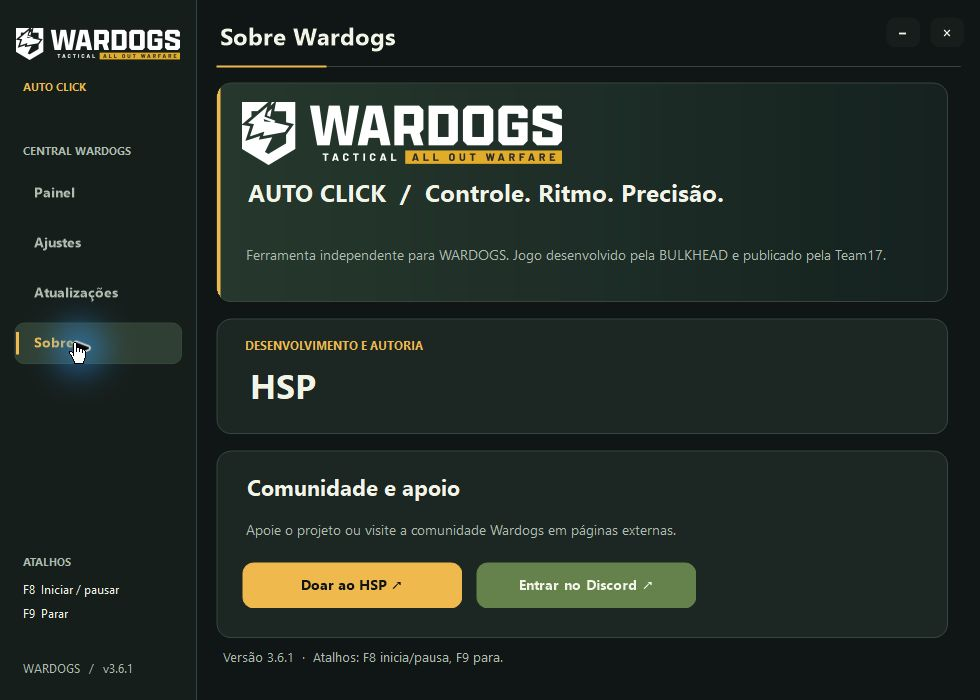

# AutoClick WARDOGS

Autoclicker com janela para a tela **"Selecione a facção"**: clica sem parar no card do time e para sozinho quando a tela some.

Ferramenta independente para WARDOGS, desenvolvida por **HSP**. O jogo é desenvolvido pela BULKHEAD e publicado pela Team17.

## Interface v3.6.1

**Painel de comando:** estado da sessão, controles, indicador animado, métricas e histórico.



**Ajustes:** ritmo de cliques, movimento do mouse, parada automática e avisos.



**Atualizações:** versão instalada, verificação e novidades.



**Sobre:** marca do jogo, autoria do AutoClick e acesso à comunidade.



## Como usar

1. Baixe o **`AutoclickerWardogs-Setup.exe`** da [última versão](https://github.com/soumarciosantos/autoclicker-wardogs/releases/latest) e instale. Não pede administrador; cria atalhos no Menu Iniciar e (opcional) na área de trabalho.
   - Prefere sem instalar? Baixe o `AutoclickerWardogs.exe` da mesma página e abra direto.
   - Para remover: **Configurações → Aplicativos → Aplicativos instalados → Autoclicker Wardogs → Desinstalar**.
2. No jogo, deixe o mouse sobre o card do time e aperte **F8**.

Requer Windows 10 ou 11 (usa o .NET Framework 4.8, que já vem no sistema).

| Tecla | Ação |
|---|---|
| F8 | Liga / pausa (usa a posição atual do mouse) |
| F9 | Para a sessão |

Dicas:
- Use o jogo em modo **janela sem borda**; em tela cheia exclusiva os cliques simulados podem ser ignorados.
- Na primeira vez, o Windows pode mostrar "O Windows protegeu o computador" porque o programa não é assinado. Clique em **Mais informações → Executar assim mesmo**.

## Atualizações

Ao abrir, o programa confere o `update.json` deste repositório quando os avisos estão ativados. Se houver versão nova, mostra as novidades; após você escolher **Atualizar agora** ou **Instalar atualização**, baixa o novo `.exe`, confere o SHA-256, troca o arquivo e reabre.

Quem ainda usa a versão antiga em PowerShell (2.0.0) recebe automaticamente uma atualização que baixa o `.exe`.

## Desenvolvimento

Código em `src/AutoclickerWardogs` (C#, WinForms, .NET Framework 4.8). Para compilar:

```
dotnet build src/AutoclickerWardogs -c Release -o dist
```

### Publicar uma nova versão

1. Aumente `<Version>` em `src/AutoclickerWardogs/AutoclickerWardogs.csproj`.
2. Adicione as mudanças no topo de `src/AutoclickerWardogs/novidades.json`.
3. Rode `.\publicar.ps1`. Ele compila, gera o instalador (`instalador/AutoclickerWardogs.nsi`), gera o `update.json`, cria a release com o instalador e o `.exe` no GitHub e envia tudo.

Para gerar o instalador é preciso o NSIS 3: `winget install NSIS.NSIS`.

### Ícone

O ícone da v3.6.1 está em `src/AutoclickerWardogs/icone.ico`. A marca exibida na interface está em `src/AutoclickerWardogs/WD_Fullmark_Full.png`, proveniente do [press kit da Team17](https://www.team17.com/press-and-creator-hub). O gerador antigo de ícone do mascote não corresponde mais à interface atual.
